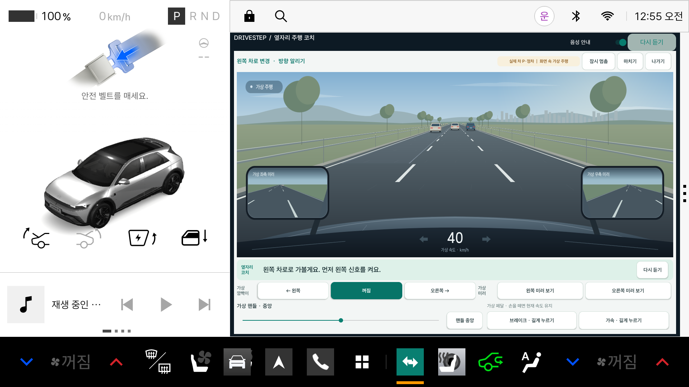

# DriveStep · 드라이브스텝

초보 운전자가 조작법을 듣고, 직접 연습하고, 피드백과 기록으로 복습하는 **Pleos / Android Automotive용 운전 코치 프로토타입**입니다. GitHub 저장소 이름은 `chageun`이며, 현재 앱 이름과 Gradle 프로젝트 이름은 **드라이브스텝 / DriveStep**입니다.

현재 버전은 **v0.7.0**입니다. 정차 중 사용하는 **운전자 시점의 차로 변경 시뮬레이션**, 상황반응 코치, SDK 기반 조작 연수를 제공합니다. 검증 범위는 Pleos 에뮬레이터이며 실차 주행 코칭이나 운전 교육 효과를 검증한 제품은 아닙니다.



## 주요 기능과 사용 흐름

앱은 차량 플랫폼이 정차 사용을 허용한 상태에서 이용합니다. 에뮬레이터에서는 차량 상태를 **P·속도 0**으로 준비하세요. 주행 제한이나 앱 이탈이 발생하면 연습과 음성을 중단하며, 복귀 후에는 명시적으로 다시 시작하거나 이어갑니다.

| 홈에서 선택할 기능 | 사용 흐름 | 입력의 출처 |
|---|---|---|
| **도로를 보며 직접 연습 · 차로 변경** | 전방 도로·주변 차량 보기 → 신호·미러·핸들·페달 직접 조작 → 상황별 음성 → 회고 | 같은 가상 월드의 위치·속도·교통 차량 |
| **상황 감지 변수 확인 · 개발용** | 방향지시와 감속/가속 또는 차로 변경 경고 입력 → 자동 안내 → 반응 근거 확인 → 해당 상황 복습 | 화면에서 만든 **가상 신호** |
| **방향지시등 · 코치와 시작** | 조작법 듣기 → 왼쪽 켜기·끄기 → 오른쪽 켜기·끄기 → SDK 수신 기록 확인 | Pleos SDK 방향지시등 변경 신호 |
| **핸들 · 코치와 시작** | P·정지·조향 신호 확인 → 왼쪽·중앙·오른쪽·중앙 → 조작 기록 복습 | Pleos 조향 신호와 AAOS 기어·속도 |
| **조작형 연수 체험 열기** | 화면 속 브레이크·기어·가속·핸들 조작 → 출발·정지 / 횡단보도·신호 대기 → 회고 | 실제 차량과 분리된 **가상 조작·주행 모델** |
| **처음이라면 · 시트와 미러 맞추기** | 체격 참고 정보 선택 → 시트·페달·핸들·미러 등 6개 항목 직접 확인 | 사용자의 수동 확인 |
| **내 조작 기록 · 복습** | SDK 조작 연수의 완료·중단 및 수신 이벤트 확인 | 앱 내부에 저장된 연수 기록 |

운전자 시점 시뮬레이션에서는 **왼쪽 차로 변경, 오른쪽 차로 변경, 옆 차를 기다린 뒤 변경**을 연습합니다. 차선·주변 차량·가상 미러가 같은 상태에 따라 움직이고, 잘못된 방향이나 급격한 속도 변화에 짧은 음성으로 반응합니다. 실제 차량은 P·정차를 유지합니다. [조작 방법과 구현 범위](docs/DRIVING_SIMULATOR.md)를 참고하세요.

개발용 상황반응 코치에서는 방향지시등, 속도, 차로 변경 경고, 기어, 브레이크, 조향각, 도로 문맥, 차량 경고음 우선 조건을 바꿀 수 있습니다. 세 가지 상황 예시로 시작하거나 직접 입력을 조합하고, 저장된 입력 순서를 재현할 수 있습니다. 차량 경고음 우선 조건에서는 추가 코치 발화를 억제합니다. 세부 규칙과 실험값은 [상황 코치 설계](docs/SITUATION_COACH.md)에 있습니다.

에뮬레이터의 SDK 조작 연수는 가상 차량 콘솔에 입력한 값이 **실제 SDK 경로로 수신되는지** 확인합니다. 여기서 ‘SDK 신호’는 실차에서 시험했다는 뜻이 아닙니다. 기존 객관식 과정은 **기존 교통상식 학습 자료**에 보조 자료로 남아 있습니다.

## 구현 범위

- 상황 코치의 속도 변화·경고 감지는 현재 가상 입력에 연결되어 있습니다. 실주행 자동 감지, 실차 경고 API 연결, 안전한 차로 변경 가능 여부 판단은 구현하지 않았습니다.
- SDK 조향값은 **전륜 조향각**이며 핸들 회전 수가 아닙니다. 시트·미러는 자동 조절하거나 센서로 자세를 판정하지 않습니다.
- 가상 D/R 선택과 가상 페달은 실제 차량을 제어하지 않습니다. 화면의 도로·보행자·신호는 작성된 교육용 상황이며 실제 제동거리·충돌 예측 모델이 아닙니다.
- 확보해 검토한 Vehicle SDK 2.3.2 범위에서 전방 영상·차선·주변 객체 인식 API를 확인하지 못했습니다. 주변 차량·보행자 인식이나 주차 공간 계산 기능은 연결되어 있지 않습니다.
- 현대자동차의 공식 기본 탑재 앱이 아니며, 주행 중 사용 승인과 차종별 실차 신호·코칭 효과 검증은 남아 있습니다. 상세 범위는 [제품 방향](docs/COACH_PRODUCT_DIRECTION.md)을 참고하세요.

한국어 TTS와 앱에 포함한 고정 한국어 음성 파일을 사용합니다. TTS를 사용할 수 없을 때는 번들 음성으로 안내하며, LLM으로 주행 상황을 추측해 지시하는 기능은 없습니다.

## 개발 환경

| 항목 | 프로젝트 설정 / 확인 환경 |
|---|---|
| 언어·UI | Kotlin, Android View / Canvas |
| JDK | 17 |
| Gradle / Android Gradle Plugin | Wrapper 8.10.2 / 8.8.2 |
| Kotlin Gradle Plugin | 2.0.0 |
| Android SDK | compileSdk 35, targetSdk 34, minSdk 28 |
| 차량 SDK | `ai.pleos.playground:Vehicle:2.3.2`, `android.car` |
| 앱 ID | `kr.drivestep.tutor` |
| 기존 실행 검증 환경 | Pleos 에뮬레이터 2.1.0 / Android 14 |

빌드에는 JDK 17, Android SDK Platform 35와 Build Tools가 필요합니다. 실행에는 Pleos 차량 서비스가 제공되는 Automotive 환경이 필요하며, 일반 휴대폰이나 일반 Android 에뮬레이터만으로 차량 연동을 검증할 수 없습니다.

최초 빌드는 Gradle과 의존성을 내려받으므로 Google Maven, Maven Central 및 [설정된 Pleos Maven 저장소](https://nexus-playground.pleos.ai/repository/maven-releases/)에 접근할 수 있어야 합니다. Pleos SDK 아티팩트와 에뮬레이터 이미지의 제공·접근 조건은 별도로 확인하세요. 배포 경로에 따라 계정이나 접근 권한이 필요할 수 있습니다. 연결 근거는 [SDK 연동 메모](docs/SDK_NOTES.md)에 정리되어 있습니다.

**개발자가 사용한 `.tooling/`의 Android SDK·에뮬레이터·AVD와 `local.properties`는 저장소에 포함하지 않습니다.** 각 개발 환경에서 도구와 Pleos 이미지를 준비해야 합니다.

## 소스 받기와 빌드

```bash
git clone https://github.com/Specters-of-the-Middle-Way/chageun.git
cd chageun
```

### Android Studio

1. AGP 8.8.2를 지원하는 Android Studio에서 저장소 루트의 `settings.gradle.kts`를 엽니다.
2. Gradle JDK를 **17**로 설정하고 SDK Manager에서 Android SDK Platform 35와 필요한 Build Tools를 설치합니다.
3. SDK 위치를 설정하고 Gradle Sync를 실행합니다. SDK 의존성 다운로드가 실패하면 저장소 접근과 Pleos 아티팩트 제공 상태를 확인합니다.
4. 별도로 준비한 Pleos 에뮬레이터를 시작하고 `app`의 `debug` 변형을 실행합니다.

### 명령행

다음 경로는 예시입니다. 설치된 JDK와 Android SDK 경로로 바꾸세요. Windows에서는 `./gradlew` 대신 `gradlew.bat`를 사용합니다.

```bash
export JAVA_HOME="/path/to/jdk-17"
export ANDROID_HOME="/path/to/android-sdk"
export PATH="$JAVA_HOME/bin:$ANDROID_HOME/platform-tools:$ANDROID_HOME/emulator:$PATH"

./gradlew :app:assembleDebug :app:testDebugUnitTest :app:lintDebug
```

Debug APK는 `app/build/outputs/apk/debug/app-debug.apk`에 생성됩니다. `:app:assembleRelease`로 release 빌드도 확인할 수 있으며, 배포용 서명 설정은 별도로 구성해야 합니다.

macOS/Linux에서는 `./scripts/build.sh`로 같은 debug 빌드·단위 테스트·lint를 실행할 수 있습니다. 이 스크립트는 `scripts/env.sh`를 통해 환경을 찾으며, 프로젝트에 `.tooling/android-sdk`가 있으면 해당 SDK를 우선 사용합니다.

## Pleos 에뮬레이터 실행

Pleos 이미지를 별도로 설치하고 AVD를 만든 뒤 실행합니다. AVD 이름은 자신의 환경에 맞게 바꿀 수 있습니다.

```bash
DRIVESTEP_AVD="your-pleos-avd" ./scripts/run-emulator.sh
```

부팅이 끝나면 다른 터미널에서 위의 SDK 환경 변수를 설정하고 앱을 설치합니다. 기기가 여러 대 연결되어 있으면 `adb devices`에서 대상 에뮬레이터를 확인해 `ANDROID_SERIAL`을 지정하세요.

```bash
adb devices
export ANDROID_SERIAL="emulator-5554" # 실제 대상 serial로 변경
./scripts/install.sh
```

`install.sh`는 debug APK를 `adb install -r`로 설치하고 현재 차량 사용자로 앱을 엽니다. 기존 앱 데이터를 지우지 않으며, Virtual Console용 `8088` 포트를 전달합니다. [로컬 Virtual Console](http://127.0.0.1:8088/) 또는 debug 앱의 에뮬레이터 조작 패널로 SDK 신호를 시험할 수 있습니다. PC용 한국어 시험 패널은 `python3 scripts/control-panel.py` 실행 후 [로컬 시험 패널](http://127.0.0.1:8090/)에서 사용할 수 있습니다.

`scripts/launch-tutor.command`는 **기존 개발 환경의 `.tooling/avd/DriveStep_Pleos.avd`가 준비된 macOS용 도우미**입니다. clone만 한 환경에서 바로 실행되는 설치 도구가 아니며, APK가 이미 있으면 다시 빌드하지 않으므로 소스 변경 후 먼저 빌드해야 합니다.

## 테스트와 검증 기록

단위 테스트는 상황 감지 규칙, 방향지시등·조향 상태 전이, 가상 주행 과정과 기존 학습 과정을 다룹니다. 로컬 저장소의 Android 계측 테스트는 `app/src/androidTest`에 있습니다.

```bash
# 기기 없이 실행하는 단위 테스트와 정적 검사
./gradlew :app:testDebugUnitTest :app:lintDebug

# 연결된 테스트 기기에서 저장소 계측 테스트
./gradlew :app:connectedDebugAndroidTest

# Pleos 에뮬레이터에 debug APK를 설치한 뒤 실행하는 통합 검사
python3 -u scripts/verify-coach.py
python3 -u scripts/verify-situation.py
python3 -u scripts/verify-simulator.py
```

Python 검증 도구는 `adb`가 PATH에 있고 Pleos Virtual Console이 동작하는 환경을 전제로 합니다. Python의 `sqlite3.Connection.deserialize` 지원도 필요합니다. 이 도구는 **에뮬레이터 전용**이며 기어·속도·방향지시등 등을 변경하고 연습 기록을 추가합니다. 기존 기록은 삭제하지 않지만 `docs/screenshots/`의 검증 화면은 갱신합니다. 콘솔 HTTP 경로는 해당 에뮬레이터에서 관찰한 시험용 구현이므로 다른 이미지 버전에서는 확인이 필요합니다.

**v0.7 검증 결과:** Debug/Release 빌드, lint(오류 0), **단위 테스트 148개**, 운전자 시점 시뮬레이터 통합 검사를 통과했습니다. [실행 화면과 검증 범위](docs/DRIVING_SIMULATOR_VALIDATION.md)를 참고하세요.

**기존 검증 결과:** [2026-11-08 v0.6 검증 기록](docs/COACH_VALIDATION.md)에 Debug/Release 빌드, lint, **단위 테스트 123개**, 두 통합 검사 통과가 기록되어 있습니다. 이는 Pleos 2.1.0 / Android 14 에뮬레이터에서 수행한 당시 결과이며, 새 개발 환경이나 실차에서의 통과를 보장하지 않습니다. 문서에서 참조하는 원본 로그와 `docs/test-results/`의 결과 파일은 로컬 검증 산출물로, 공개 저장소에는 포함하지 않습니다.

## 프로젝트 구조

```text
app/src/main/java/kr/drivestep/tutor/
├── MainActivity.kt         # 코치 홈, 화면 연결, 수명주기
├── ParkedGate.kt           # 차량 플랫폼의 정차 사용 제한 확인
├── SteeringFeature.kt     # 조향 연수 연결·진행·저장 제어
├── simulator/             # 운전자 시점 도로·미러, 직접 조작, 연속 가상 모델
├── contextcoach/          # 상황 감지 규칙, 가상 입력, 근거·복습
├── vehicle/               # Pleos/AAOS 읽기와 변경 구독
├── practice/              # 방향지시등·조향 연수 상태 모델
├── coach/                 # 조작 안내와 음성 코치
├── ride/                  # 가상 페달·기어·조향 연수
├── growth/                # 자세 설정, 기존 교통상식 과정·진도
├── tutor/                 # 기존 주차 이해 학습
└── data/                  # SDK 조작 기록 저장·복구
app/src/main/res/raw/       # 고정 한국어 안내 음성
app/src/debug/              # 에뮬레이터 전용 조작 도구·네트워크 설정
app/src/release/            # 에뮬레이터 도구를 비활성화한 구현
app/src/test/               # JVM 단위 테스트
app/src/androidTest/        # Android 저장소 계측 테스트
scripts/                   # 빌드·실행·음성 생성·에뮬레이터 검증 도구
docs/                      # 설계, SDK 근거, 검증 기록·화면
```

## 데이터 저장

기록은 현재 Android 사용자에 속한 앱 내부 저장소에 보관합니다. 방향지시등 연수는 SQLite(`drivestep-practice.db`), 조향 연수는 JSON(`steering-practice.json`), 가상 상황·주행 회고·기존 학습 진도·체격 선택·음성 설정은 SharedPreferences를 사용합니다. 상황 기록과 가상 주행 회고는 각각 최근 20회를 보관하며 SDK 조작 기록과 구분합니다.

앱에 외부 서버로 기록을 업로드하는 기능은 없고 Android 백업은 비활성화되어 있습니다. Release에는 `INTERNET` 권한을 선언하지 않으며, debug의 네트워크 권한은 에뮬레이터 시험 도구에 사용합니다. 앱 데이터 삭제 또는 제거 시 로컬 기록도 삭제됩니다.

## 관련 문서와 개발 시 유의점

- [운전자 시점 시뮬레이터](docs/DRIVING_SIMULATOR.md), [v0.7 검증 기록](docs/DRIVING_SIMULATOR_VALIDATION.md)
- [상황 코치 변수·발동 조건](docs/SITUATION_COACH.md), [제품 방향과 미구현 범위](docs/COACH_PRODUCT_DIRECTION.md)
- [v0.6 통합 검증 기록](docs/COACH_VALIDATION.md), [기어·조향 신호 검증](docs/STEERING_VALIDATION.md)
- [SDK 연동·권한 메모](docs/SDK_NOTES.md), [초기 방향지시등 검증](docs/VALIDATION.md)
- [기존 성장 튜터 검증](docs/GROWTH_VALIDATION.md), [학습 자료 출처](docs/GROWTH_SOURCES.md)

변경할 때는 가상 입력과 SDK 관측의 출처를 유지하고, 미확인 신호를 정상·안전으로 간주하지 마세요. SDK 연결 성공과 실제 데이터 수신, 초기 GET과 변경 이벤트를 구분해야 합니다. 주행 제한, 신호 만료, 반대 조작, 앱 이탈, 기록 복구를 관련 테스트에서 함께 확인하고 변경한 동작과 검증 환경을 PR에 적어 주세요. 에뮬레이터 전용 콘솔 경로·조향 보정을 실차 구현에 그대로 적용하지 않습니다.

자격 증명, `local.properties`, SDK·AVD, 빌드 산출물과 개인 차량 기록은 커밋하지 않습니다. 음성 문구를 바꿀 때는 코드·`docs/*-voice-cues.json`·번들 음성을 함께 확인하세요. 일반 빌드에는 이미 포함된 음성을 사용하므로 음성 생성 스크립트를 실행할 필요가 없습니다.
