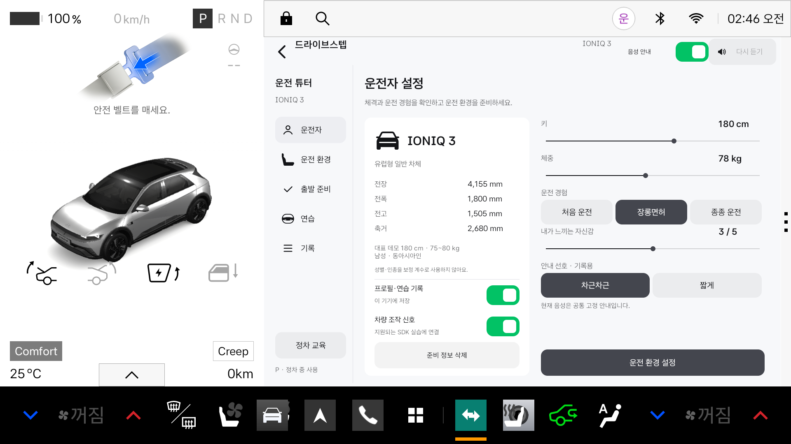

# 차근 · Chageun

초보 운전자가 조작법을 듣고, 직접 연습하고, 피드백과 기록으로 복습하는 **Pleos / Android Automotive용 운전 코치 프로토타입**입니다. 앱 이름은 **차근(Chageun)**, GitHub 저장소 이름은 `chageun`, Gradle 프로젝트 이름은 `DriveStep`입니다.

현재 버전은 **v0.10.0**입니다. **함께하는 연수**에서 짧은 음성 대화, 다음 회전 준비 안내, 차량 조작 기록, 복습과 다음 연습을 연결합니다. Pleos STT·TTS 3.3.1과 NaviHelper 3.0.5를 추가했으며, 실제 SDK 입력과 가상 시험 입력을 구분합니다. [실행 방법과 구현 범위](docs/INTERACTIVE_LESSON.md)를 먼저 확인하세요.

Mac의 실제 마이크를 시험할 때는 실행 앱(Codex·Terminal·Android Studio 등)의 macOS 마이크 권한과 에뮬레이터의 호스트 마이크 입력을 확인하세요. 이번 Emulator 37.2.13에서는 `bash scripts/run-emulator.sh -allow-host-audio`로 완전히 재시작한 뒤 실제 발화를 확인했습니다. [마이크 설정과 듣기·답변 순서](docs/INTERACTIVE_LESSON.md#mac에서-실제-마이크로-시험하기)를 참고하세요.

**함께하는 연수 → 함께 시작하기**로 들어가면 첫 안내가 끝난 뒤 자동으로 듣습니다. 질문에 답할 때마다 마이크 버튼을 누르지 않아도 됩니다. **듣기 준비됨**일 때 말하고, 끝내려면 **대화 종료**를 누르거나 말하세요. 입력 시간 초과나 화면 이탈 후에는 자동으로 다시 켜지지 않습니다.

자연어 대화를 시험하려면 [외부 LLM 설정·검증 안내](docs/LLM_TUTOR.md)를 참고하세요. 기존 Pleos STT·TTS를 유지하며, API 키는 Git에서 제외된 `backend/.env`에만 설정합니다. Debug 앱의 **AI 대화 사용**을 켠 경우에만 최근 대화와 차량 상태를 로컬 중계 서버를 거쳐 OpenAI에 전달합니다. 키가 없는 시험 서버의 응답은 실제 LLM 응답과 구분해 표시합니다.

**최종 목표(2026-11-10):** 운전자가 상황을 매번 설명하지 않아도 차량 신호·비전 인식으로 먼저 안내하는 연수 튜터입니다. 현재 외부 LLM 대화는 주변 인식 데이터 확보 전의 임시 시험 경로이며, 최종 자동 안내는 외부 LLM 없이 동작하는 방향입니다. [제품 방향·SDK 확인·첨부 지시서 검토](docs/COACH_PRODUCT_DIRECTION.md)를 후속 작업의 기준으로 참고하세요.

**Pleos Connect 공식 디자인 에셋의 벡터 아이콘·스위치·체크박스**와 공식 색상 토큰을 사용하는 네이티브 UI입니다. 사용자가 제공한 상세 플로우차트에 따라 **프로필 → 자세·미러 설정 → 출발 전 확인 → 가상 주행·주차 → 복습 → 재방문 확인**으로 연결했습니다. 대표 차종은 **IONIQ 3 유럽형 일반 차체**, 데모 체격은 **180cm·78kg**입니다.

**처음 받은 팀원:** [설치부터 시작](#setup) → [앱 실행](#run) · [터미널 실행](#terminal) · [문제 해결](#troubleshooting)

**기획·개발 에이전트 참고:** [AI 에이전트용 서비스·구현 워크플로우](docs/AI_AGENT_WORKFLOW.md) — 사용자 원문 기반의 기능 흐름, 구현 순서, 수용 테스트를 정리한 제안서입니다. 작성 기준 커밋과 최신 구현의 차이를 구분해 사용합니다.



## 준비와 연습 워크플로우

상단 **준비와 연습**에서 날씨 미확인/가상 날씨 예시, 출처가 구분된 가상 기능 학습, 목표별 가상 코스, D01~D18 조작 과제, T자·전면을 포함한 네 가지 주차 연습과 복습을 연결합니다. 실제 날씨·제조사 설명서·초보자 실경로 추천·거리 센서는 미연결 범위를 표시합니다. 별도 연결 화면의 실제 위치·내비 기능과 가상 코스를 구분합니다. 기존 프로필·자세·출발 전 확인과 음성 연수는 유지합니다. [요구사항 대응표·정리한 기능·실행 방법·남은 의존성](docs/WORKFLOW_IMPLEMENTATION.md)을 확인하세요.

## 공모전 공개 SDK 연결과 향후 계획

2026-11-11 운영사무국 회신을 반영했습니다. **ADAS SDK는 이번 공모전에서 사용할 수 없습니다.** 차량 카메라 원본·주변 객체·후측방 거리·미러 각도 자동 조절은 향후 계획으로 분리하고, 사진·녹화·웹캠 대체 시연은 실제 차량 입력과 구분합니다. [공모전 범위와 향후 계획](docs/CONTEST_SCOPE.md)을 참고하세요.

상단 **준비와 연습 → 차량 상태 · 위치와 내비**에서 시트 앞뒤·높이·등받이·안전벨트 버클과 차량 경고를 확인할 수 있습니다. 차량 신호는 기존 운전자 설정의 선택 동의가 필요합니다. 시트 이동 시 관련 자세·미러·출발 전 확인을 다시 요구하며, 버클 신호만으로 올바른 착용을 자동 인증하지 않습니다. 실제 시트·미러를 이동시키지 않습니다.

위치·내비는 별도로 이용을 선택하고 위치 런타임 권한을 허용합니다. FusedLocation 1.1.3의 위치와 NaviHelper 3.0.5의 경로 상태·목적지·다음 안내를 읽고, FusedLocation과 내비 기준 위치는 각각 표시하며 에뮬레이터 기본 좌표가 다를 수 있습니다. 직접 입력한 목적지는 확인 후 차량 내비에 요청합니다. 기존 목적지가 바뀔 수 있습니다. 가상 추천 코스를 실제 내비 경로로 보내지 않으며, 요청 전송·경로 탐색 완료·목적지 일치를 구분합니다. 좌표·목적지는 앱 기록에 저장하지 않습니다.

개발·시험 권한은 공개 문서의 Manifest 선언과 실제 OS 권한·capability 확인으로 처리하며, App Market 배포 심사는 별도입니다. 차량 신호는 P·정차·전경에서만, 위치·내비는 해당 화면에서 동의한 동안만 연결합니다.

## 주요 기능과 사용 흐름

앱은 차량 플랫폼이 정차 사용을 허용한 상태에서 이용합니다. 실제 에뮬레이터 차량은 **P·속도 0**으로 두고, 시뮬레이션 화면 안의 기어·핸들·페달을 조작합니다. 실제 기어를 R·D로 바꾸면 가상 연습을 제한합니다.

| 단계 | 구현한 기능 | 데이터의 출처 |
|---|---|---|
| 프로필 | 체격·경험·자신감·안내 선호 저장, 기록/차량 신호 선택 동의 | 사용자 입력; 자신감과 숙련도 구분 |
| 기초 설정 | 시트·헤드레스트·핸들·미러·벨트 9개 확인, 가상 보정 슬라이더 | 직접 확인; 실제 시트 좌표·자동 자세 판정 아님 |
| 출발 전 확인 | 7개 항목 모두 확인 후 연습 선택, 재방문 시 다시 확인 | 직접 확인; 실제 차량 출발을 허가하는 기능 아님 |
| 주행 연습 | 왼쪽·오른쪽 차로 변경, 사각지대 차량 기다림, 미러·핸들·페달·음성 | 화면 속 가상 주행 모델 |
| **주차 연습** | **후진·T자·평행·전면 주차**, R/D/P·핸들·페달, 이동 궤적·가상 충돌·위치 조정 | IONIQ 3 공개 차체 크기와 교육용 물리 가정 |
| 복습 | 관측한 가상 조작과 자기 평가를 구분, 동의 시 최근 기록 보관 | 앱의 가상 연습 기록; 실차 운전 점수 아님 |
| 보조 SDK 실습 | 방향지시등·조향 신호 수신 및 조작 복습 | Pleos 에뮬레이터 SDK; 선택 동의 필요 |
| 함께하는 연수 | 음성 요청·방향 확인 질문 → 준비 안내 → 조작 타임라인 → 복습·다음 연습 | 운전자 진술 / SDK 차량 값 / 내비 정보 / 가상 입력을 구분 |

주차는 퀴즈가 아니라 직접 조작하는 연습입니다. **브레이크 유지 → 진입 기어 선택(후진·T자·평행은 R, 전면은 D) → 브레이크 유지 해제 → 가속을 조금씩 누름 → 핸들 조정 → 브레이크 유지 다시 켬 → 속도 0 확인 → P → 주차 마침** 순서로 진행합니다. 정렬·충돌 판정은 가상 차체와 가상 공간에만 적용합니다. 후진 주차는 직선 후진 입문 코스이며, 평행 주차에서는 조향을 바꾸며 두 차량 사이에 들어가야 합니다. T자 후진 직각주차와 전면 주차는 각각 다른 시작 자세에서 조향해 구역에 진입하는 별도 가상 코스입니다.

자세 보정 값은 0~100의 **가상 수동 설정값**이고 기본값 50은 중립 시작점입니다. 키·체중·성별·인종으로 안전한 시트 좌표를 계산하는 AI는 구현하지 않았습니다. 실제 시트의 이동 범위·페달 위치·신체 치수 검증이 먼저 필요합니다. 시트나 핸들 값을 바꾸면 미러 확인을 다시 하게 합니다.

공식 배포 `Pleos_Connect_design_assets_215.fig`에서 변환한 **벡터 리소스 34개**(아이콘 30개·스위치 상태 2개·체크박스 상태 2개)를 포함합니다. 각 화면에는 필요한 에셋만 사용합니다. 원본 path와 노드 변환을 보존해 Android VectorDrawable로 변환했으며, 프로필·자세·연습 선택 화면의 자체 제작 차량·사람·코스 그림을 제거했습니다.

`PleosUi`·`PleosSwitch`는 공식 디자인 에셋을 Android의 버튼·선택·접근성에 연결하는 앱 코드입니다. **Asta Sans** 원본은 유지하면서 일반 글씨 400·굵은 글씨 700을 지정했습니다. 도로·주차장·차량 윤곽과 예상 경로는 동작하는 시뮬레이션을 위한 앱 자체 렌더링입니다. [실제 적용 에셋과 구현 구분](docs/V09_OFFICIAL_ASSETS.md), [원본·변환 출처](third_party/pleos/README.md)를 참고하세요.

[플로우차트 반영 범위와 제원 근거](docs/V08_FLOWCHART_IMPLEMENTATION.md), [기존 차로 변경 모델](docs/DRIVING_SIMULATOR.md)을 참고하세요.

## 구현 범위

- 상황 코치의 속도 변화·경고 감지는 현재 가상 입력에 연결되어 있습니다. 실주행 자동 감지, 실차 경고 API 연결, 안전한 차로 변경 가능 여부 판단은 구현하지 않았습니다.
- SDK 조향값은 **전륜 조향각**이며 핸들 회전 수가 아닙니다. 시트·미러는 자동 조절하거나 센서로 자세를 판정하지 않습니다.
- 가상 D/R 선택과 가상 페달은 실제 차량을 제어하지 않습니다. 화면의 도로·보행자·신호는 작성된 교육용 상황이며 실제 제동거리·충돌 예측 모델이 아닙니다.
- 확보해 검토한 Vehicle SDK 2.3.2 범위에서 전방 영상·차선·주변 객체 인식 API를 확인하지 못했습니다. 주변 차량·보행자 인식이나 주차 공간 계산 기능은 연결되어 있지 않습니다.
- 현대자동차의 공식 기본 탑재 앱이 아니며, 주행 중 사용 승인과 차종별 실차 신호·코칭 효과 검증은 남아 있습니다. 상세 범위는 [제품 방향](docs/COACH_PRODUCT_DIRECTION.md)을 참고하세요.

기존 연습은 Android 한국어 TTS와 194개 고정 음성을 사용합니다. 새로운 함께하는 연수는 **Pleos STT·TTS의 ON_DEVICE 모드**를 사용하고, Pleos 음성 출력이 실패하면 Android 한국어 TTS로 전환한 사실을 표시합니다. 동적 대화 문장에는 번들 WAV 대체가 없습니다. 음성 인식 실패 시에는 명확히 표시된 시험 문장 입력으로 흐름을 확인할 수 있습니다. LLM으로 주변 교통상황을 만들어 내거나 진입 가능 여부를 판정하지 않습니다.

<a id="setup"></a>

## 팀원 설치 가이드 — 처음 받는 PC 기준

**진행 순서: 도구 설치 → 소스 받기 → JDK·SDK 설정 → Pleos 이미지·가상 기기 생성 → 앱 실행.** 아래 절차는 저장소 밖에 준비된 개발 도구를 사용하는 방법입니다. 개발자의 `.tooling/`, SDK·AVD·APK·`local.properties`는 GitHub에 포함되지 않습니다.

공식 설치 문서 확인일은 **2026-11-09**입니다. 메뉴 이름은 Android Studio 버전에 따라 조금 다를 수 있습니다. 앱의 기존 실행 검증 환경은 **macOS Apple Silicon / Pleos 2.1.0 / Android 14**이며, Windows·Linux의 설치 단계는 공식 가이드 기준입니다.

### 1. Android Studio와 Git 설치

1. [Android Studio 공식 다운로드·설치 안내](https://developer.android.com/studio/install)에서 **안정 버전**을 설치합니다. Mac은 CPU에 맞는 설치 파일을, Windows는 설치 프로그램을 선택합니다.
2. 처음 실행되는 Setup Wizard를 끝까지 진행해 기본 Android SDK 도구를 받습니다.
3. 터미널에서 소스를 받을 팀원은 [Git](https://git-scm.com/downloads/)도 설치하고 `git --version`이 출력되는지 확인합니다. Git 없이 시작하려면 다음 단계의 ZIP 방식을 사용합니다.

PC 메모리는 Studio와 Emulator를 함께 실행할 때 **최소 16 GB, 권장 32 GB**를 기준으로 확인하세요. Windows/Linux의 Intel·AMD PC는 하드웨어 가상화도 켜져 있어야 합니다. Windows/Linux ARM PC는 현재 Android Studio 공식 지원 대상이 아닙니다. 자세한 OS·GPU 요구사항은 위 공식 설치 안내를 따릅니다.

이 프로젝트의 **AGP 8.8.2**를 지원하는 Studio를 사용합니다. Ladybug Feature Drop 2024.2.2부터 해당 AGP 계열을 지원하며, 새로 설치할 때는 [공식 호환 표](https://developer.android.com/studio/releases#android_gradle_plugin_and_android_studio_compatibility)를 확인하세요. 프로젝트가 제안하는 **AGP·Gradle 업그레이드는 일단 적용하지 않고**, 저장소에 고정된 버전으로 첫 실행을 맞춥니다.

### 2. GitHub에서 받기 → 프로젝트 열기

터미널 또는 Windows PowerShell에서 프로젝트를 보관할 폴더로 이동한 뒤 실행합니다.

```bash
git clone --branch main https://github.com/Specters-of-the-Middle-Way/chageun.git
cd chageun
```

Git 없이 받으려면 GitHub의 **Code → Download ZIP**을 선택하고 압축을 풉니다. 이 경우 폴더 이름은 보통 `chageun-main`이며 이후 업데이트는 다시 내려받아야 합니다.

Android Studio의 **Open** 또는 **File → Open**에서 `chageun` 폴더를 선택합니다. **`settings.gradle.kts`, `gradlew`, `app/`가 함께 들어 있는 최상위 폴더**를 여세요. `app/`만 열거나 새 Android 프로젝트를 만들 필요는 없습니다. 처음 열었을 때 Sync가 실패해도 다음 단계에서 JDK·SDK를 지정한 뒤 다시 실행하면 됩니다.

### 3. Gradle JDK 17과 Android SDK 설치

**JDK 설정**

1. Windows/Linux는 **File → Settings**, macOS는 **Android Studio → Settings**를 엽니다.
2. **Build, Execution, Deployment → Build Tools → Gradle → Gradle JDK**로 이동합니다.
3. **JDK 17**을 선택합니다. 없으면 **Download JDK**에서 버전 17을 받거나 **Add JDK**로 이미 설치한 JDK 17 경로를 지정합니다.
4. 터미널 빌드도 사용할 경우 이 설치 경로를 기록합니다. 아래 명령의 `JAVA_HOME`에 같은 경로를 넣습니다.

IDE를 실행하는 내장 런타임과 프로젝트를 빌드하는 Gradle JDK는 별도 설정입니다. Android Studio 자체 런타임을 바꾸는 대신 **Gradle JDK만 17로 지정**합니다. [Android 공식 JDK 설정](https://developer.android.com/build/jdks)

**SDK 설정**

**Tools → SDK Manager**를 엽니다. 시작 화면에서는 **More Actions → SDK Manager**로 들어갈 수 있습니다.

| 탭 | 설치할 항목 | 용도 |
|---|---|---|
| SDK Platforms | **Android 15 / API 35 / Android SDK Platform 35** | 앱 컴파일, `android.car` 컴파일 라이브러리 |
| SDK Tools | **Android SDK Build-Tools 35.0.0** | APK 빌드; 안 보이면 Show Package Details 선택 |
| SDK Tools | **Android SDK Platform-Tools** | `adb`로 기기 연결·앱 설치 |
| SDK Tools | **Android Emulator** | 가상 기기 실행 |
| SDK Tools | Android SDK Command-line Tools (latest) | 선택: `sdkmanager` 등 명령행 SDK 관리 |

선택 후 **Apply / OK**로 다운로드를 완료합니다. Build Tools 35.0.0은 AGP 8.8의 기본 버전이며, 별도의 `buildToolsVersion` 설정을 추가할 필요는 없습니다. [AGP 8.8 공식 호환 정보](https://developer.android.com/build/releases/agp-8-8-0-release-notes)

**빌드용 SDK 35와 실행용 Pleos API 34 이미지는 서로 다릅니다.** 다음 단계의 이미지가 API 34여도 `compileSdk`를 34로 낮추지 마세요. SDK Platform 34 자체는 이 앱의 컴파일 필수 항목이 아닙니다.

SDK Manager 상단의 **Android SDK Location**을 확인하세요. 보통 다음 위치지만 실제 표시된 경로를 우선합니다.

| OS | 일반적인 SDK 경로 |
|---|---|
| macOS | `$HOME/Library/Android/sdk` |
| Windows | `%LOCALAPPDATA%\Android\Sdk` |
| Linux | `$HOME/Android/Sdk` |

Android Studio가 SDK 위치를 인식하면 루트의 `local.properties`에 `sdk.dir`을 기록합니다. 팀원별로 다른 로컬 파일이므로 Git에 올리지 않습니다.

이제 **File → Sync Project with Gradle Files** 또는 **Sync Now**를 실행합니다. 필요한 Gradle Wrapper·Kotlin·Vehicle SDK는 프로젝트 설정으로 내려받습니다. **Gradle 별도 설치, AAR 수동 복사, Python·Node·NDK 설치, 음성 파일 재생성은 앱 실행에 필요하지 않습니다.**

<details>
<summary>현재 프로젝트의 버전 확인표</summary>

| 항목 | 값 |
|---|---|
| JDK / Java·Kotlin 대상 | 17 |
| Gradle Wrapper / Android Gradle Plugin | 8.10.2 / 8.8.2 |
| Kotlin Plugin | 2.0.0 |
| compileSdk / targetSdk / minSdk | 35 / 35 / 28 |
| Vehicle SDK | `ai.pleos.playground:Vehicle:2.3.2` |
| 앱 ID / 실행 Activity | `kr.drivestep.tutor` / `.MainActivity` |
| 검증한 실행 이미지 | Pleos Connect 2.1.0, Android 14(API 34) |

Pleos Maven 저장소는 [settings.gradle.kts](settings.gradle.kts)에 이미 등록되어 있습니다. 첫 Sync에는 Google Maven, Maven Central, Gradle 배포 서버와 Pleos Maven에 접근할 수 있는 네트워크가 필요합니다.

</details>

### 4. Pleos 이미지 설치 → 가상 기기 만들기

**이미지 등록·설치**

1. **Tools → SDK Manager → SDK Update Sites → +**를 엽니다.
2. Name은 `Pleos Connect System Image`, URL은 아래의 본인 환경에 해당하는 주소를 입력합니다.

| 환경 | SDK Update Site URL |
|---|---|
| Mac / Apple Silicon (`arm64-v8a`) | `https://nexus-playground.pleos.ai/repository/raw-releases/connect-avd/2.x/crp-arm64-sys-img.xml` |
| Windows·Linux / Intel·AMD (`x86_64`) | `https://nexus-playground.pleos.ai/repository/raw-releases/connect-avd/2.x/crp-sys-img.xml` |

3. **SDK Platforms → Show Package Details**를 켜고, **Android 14 / API 34** 아래 **Pleos Connect v2.1.0 APIs** 시스템 이미지를 설치합니다.
4. 설치 후 Android Studio를 **재시작**합니다.

위 주소는 [Pleos 공식 설치 문서](https://document.pleos.ai/docs/connect/guide/getting-started/application-development/setup-connect-sdk-emulator)의 공개 주소입니다. Mac용 주소는 ARM 이미지이므로 Intel Mac 사용자는 지원되는 이미지·실행 환경을 별도로 확인하세요.

**AVD(Android Virtual Device) 생성**

1. **Tools → Device Manager → Create device**로 들어갑니다.
2. **Automotive → Pleos Connect v2.1.0**을 선택합니다.
3. 이름은 팀에서 알아보기 쉽게 `DriveStep_Pleos`로 정합니다. 다른 이름도 가능하지만 명령행 실행 시 같은 이름을 써야 합니다.
4. **Advanced Settings / Show Advanced Settings**에서 **Cold / Cold boot**, **RAM 4 GB**를 지정합니다. 기존 UI에서 Graphics 항목을 선택해야 하면 공식 안내에 따라 **Hardware**를 사용합니다.
5. 시스템 이미지로 **API 34 / Pleos Connect v2.1.0 APIs**를 선택하고 **Finish**를 누릅니다. Studio 버전에 따라 이미지 선택과 고급 설정의 순서는 달라질 수 있습니다.
6. Device Manager의 실행 버튼을 누르고 **플레오스 자동차 홈 화면**이 나타날 때까지 기다립니다.

일반 Pixel 가상 기기는 Pleos 차량 서비스 테스트 환경을 제공하지 않습니다. 또한 공식 문서는 Quick boot에서 VHAL을 사용할 수 없다고 안내하므로 **Cold boot**를 사용합니다. [Pleos 에뮬레이터 설정](https://document.pleos.ai/docs/connect/guide/getting-started/application-development/configure-pleos-connect-emulator)

현재 저장소 실행에는 별도로 입력할 API 키·클라이언트 시크릿이 없습니다. 공식 안내상 **Pleos 2.1.0부터 CRN 입력이 필요 없고 Vehicle State는 별도 신청 없이 사용 가능**합니다. 공모전 앱 등록·팀 프로젝트 관리는 [Pleos 프로젝트·SDK 안내](https://document.pleos.ai/docs/pleos-only/create-my-project)를 따릅니다.

<a id="run"></a>

### 5. Android Studio에서 앱 실행

1. 플레오스 에뮬레이터를 켜 둡니다.
2. Android Studio 상단 실행 구성을 **`app`**, 실행 대상 기기를 **`DriveStep_Pleos`**로 선택합니다.
3. **Build → Select Build Variant** 또는 **View → Tool Windows → Build Variants**에서 `app`을 **`debug`**로 선택합니다.
4. **Run ▶**을 누릅니다. 처음에는 의존성 다운로드와 빌드에 시간이 걸립니다.
5. 차량 화면에 **차근 → 운전자 설정**이 나타나면 성공입니다. 기존 기록이 있는 기기에는 **운전자와 차량 확인**이 먼저 나올 수 있습니다.

APK 경로는 `app/build/outputs/apk/debug/app-debug.apk`입니다. 앱 설치에 성공했는데 화면이 열리지 않으면 아래 터미널 방법의 `am start --user current` 명령으로 **현재 차량 사용자**에서 실행하세요.

### 6. 처음 실행했을 때 해볼 순서

1. 에뮬레이터 차량을 **P·속도 0** 상태로 둡니다. 상태를 바꿔야 하면 아래 Virtual Console을 사용합니다.
2. **운전자**에서 체격과 운전 경험을 확인합니다. 복습을 저장하려면 **프로필·연습 기록**을 켭니다. 꺼도 준비 과정과 가상 연습은 가능합니다.
3. 아래의 **운전 환경 설정**을 누릅니다. 시트·핸들·미러 등 9개 설명에서 **조절 및 확인 완료**를 진행하고, **출발 준비**의 7개 항목을 모두 확인한 뒤 **연습 선택**을 누릅니다.
4. **연습 → 주차**에서 후진 또는 평행 주차를 선택합니다. 화면 속 **브레이크 유지 → R → 브레이크 유지 해제 → 가속을 조금씩 누름 → 브레이크 유지 다시 켬 → 속도 0 확인 → P → 주차 마침**을 조작합니다. 조향은 화면의 가상 핸들을 씁니다.
5. **연습 → 차로 변경**에서는 안내에 맞춰 화면 속 깜빡이·미러·핸들을 조작합니다. 화면의 음성 안내 스위치와 PC·에뮬레이터 음량을 확인하세요.

**앱 화면의 가상 R/D와 에뮬레이터 차량 자체의 R/D는 다릅니다.** 가상 연습을 위해 Virtual Console에서 실제 차량 기어를 R/D로 바꾸면 정차 사용 제한 때문에 연습이 멈춥니다.

SDK 신호까지 확인하려면 **운전자**에서 기록과 차량 조작 신호 동의를 모두 켜고 **정차 중 교육 → 방향지시등 조작 / 핸들 조작**으로 들어갑니다. 핸들 실습에서 **차량 속도 읽기 허용** 버튼이 나오면 눌러 권한을 선택합니다. 일반 가상 연습의 첫 화면에서 무조건 필요한 권한 단계는 아닙니다.

### 7. Virtual Console 연결 — 차량 상태·SDK 실습용

아래 터미널 환경 설정으로 `adb`를 찾을 수 있게 한 뒤 실행합니다. `emulator-5554`는 예시이므로 **`adb devices`에 실제 표시된 serial**로 바꾸세요. 한 대만 실행해도 `-s`로 대상을 지정하면 혼동을 줄일 수 있습니다.

```bash
adb devices
adb -s emulator-5554 forward tcp:8088 tcp:8088
```

PC 브라우저에서 [Virtual Console](http://127.0.0.1:8088/)을 엽니다. **Emulation Controls → Motion → Gear Selection**에서 P를 확인하고, 차량 화면의 속도가 0인지 확인합니다. SDK 실습에서는 해당 방향지시등·조향 입력을 바꿔 앱의 수신을 확인할 수 있습니다. 콘솔은 Pleos 2.1.0 이상이 필요합니다. [공식 Console 연결 안내](https://document.pleos.ai/docs/connect/guide/getting-started/application-development/use-vehicle-emulator)

<a id="terminal"></a>

## 터미널로 빌드·실행하기 — 선택

Android Studio의 **Run**으로 실행한 팀원은 이 절차를 생략해도 됩니다. 아래 명령은 **프로젝트 루트**에서 실행합니다. JDK·SDK는 앞 단계에서 설치한 경로를 사용하며 환경 변수 설정은 현재 터미널에만 적용됩니다.

### macOS / Linux

```bash
# Android Studio에서 선택한 JDK 17의 실제 경로로 변경
export JAVA_HOME="/path/to/jdk-17"

# SDK Manager의 Android SDK Location과 같은 경로 사용
export ANDROID_HOME="$HOME/Library/Android/sdk" # macOS 기본 위치
# Linux 기본 위치라면 위 줄 대신: export ANDROID_HOME="$HOME/Android/Sdk"
export PATH="$JAVA_HOME/bin:$ANDROID_HOME/platform-tools:$ANDROID_HOME/emulator:$PATH"

java -version
./gradlew --version
./gradlew :app:assembleDebug

# Android Studio에서 이미 실행 중이면 다음 두 줄은 생략
emulator -list-avds
emulator -avd DriveStep_Pleos -no-snapshot -memory 4096
```

터미널에서 에뮬레이터를 실행하면 그 창을 계속 사용하므로 **새 터미널**을 열어 위 환경 변수를 다시 설정하고, 프로젝트 루트로 이동한 뒤 설치합니다.

```bash
adb devices
export ANDROID_SERIAL="emulator-5554" # 실제 대상 serial로 변경
adb install -r app/build/outputs/apk/debug/app-debug.apk
adb shell am start --user current -n kr.drivestep.tutor/.MainActivity
adb forward tcp:8088 tcp:8088
```

### Windows PowerShell

```powershell
# Android Studio에서 선택한 JDK 17의 실제 경로로 변경
$env:JAVA_HOME = "C:\path\to\jdk-17"
$env:ANDROID_HOME = "$env:LOCALAPPDATA\Android\Sdk"
$env:Path = "$env:JAVA_HOME\bin;$env:ANDROID_HOME\platform-tools;$env:ANDROID_HOME\emulator;$env:Path"

java -version
.\gradlew.bat --version
.\gradlew.bat :app:assembleDebug

# Android Studio에서 이미 실행 중이면 다음 두 줄은 생략
emulator -list-avds
Start-Process -FilePath "$env:ANDROID_HOME\emulator\emulator.exe" -ArgumentList "-avd", "DriveStep_Pleos", "-no-snapshot", "-memory", "4096"

# 자동차 홈 화면이 완전히 나타난 뒤 실행
adb devices
$env:ANDROID_SERIAL = "emulator-5554" # 실제 대상 serial로 변경
adb install -r app/build/outputs/apk/debug/app-debug.apk
adb shell am start --user current -n kr.drivestep.tutor/.MainActivity
adb forward tcp:8088 tcp:8088
```

설치 명령의 `-r`은 기존 앱 데이터를 유지한 채 업데이트합니다. Windows에서는 `.sh`·`.command` 대신 위 PowerShell 명령을 사용합니다.

<details>
<summary>저장소에 있는 보조 스크립트의 사용 범위</summary>

macOS/Linux에서 JDK·SDK 환경 변수를 먼저 설정한 뒤 사용할 수 있습니다.

```bash
./scripts/build.sh  # debug APK + 단위 테스트 + lint
DRIVESTEP_AVD="DriveStep_Pleos" ./scripts/run-emulator.sh
./scripts/install.sh # APK가 이미 빌드돼 있고 에뮬레이터가 켜진 상태
```

`env.sh`는 `.tooling/android-sdk`가 있으면 그 경로를 우선합니다. clone한 팀원의 환경에는 없으므로 본인의 SDK를 사용합니다. `install.sh`는 현재 차량 사용자로 앱을 열고 8088 포트를 연결합니다. 선택 도구인 PC용 한국어 시험 패널은 Python 설치 후 `python3 scripts/control-panel.py`로 실행하고 `http://127.0.0.1:8090/`에서 엽니다.

**`scripts/launch-tutor.command`는 원래 개발자의 `.tooling/avd/DriveStep_Pleos.avd`를 사용하는 도우미입니다.** 팀원이 Android Studio의 기본 위치에 만든 AVD를 자동으로 찾는 설치 프로그램이 아니므로 첫 실행 방법으로 사용하지 마세요. 또한 기존 APK가 있으면 자동 재빌드하지 않습니다.

</details>

<a id="troubleshooting"></a>

## 실행이 안 될 때

| 증상 | 먼저 확인할 내용 |
|---|---|
| 프로젝트가 아닌 폴더처럼 열리거나 `app` 실행 구성이 없음 | `settings.gradle.kts`가 있는 루트를 열었는지, Gradle Sync가 끝났는지 확인 |
| JDK 관련 오류 / `Unsupported class file major version` | Gradle JDK와 터미널 `JAVA_HOME`을 17로 맞추고 재Sync. `java -version`과 Wrapper의 `--version`도 확인 |
| `SDK location not found` | SDK Manager의 Location을 확인하고 Studio에서 SDK 경로 지정. `local.properties` 예시는 아래 참고 |
| `android-35` / Build Tools / `android.car`를 찾지 못함 | SDK Platform 35와 Build Tools 35.0.0 설치 완료 확인. API 34 이미지 설치만으로 컴파일 SDK가 준비되지는 않음 |
| Pleos 이미지·하드웨어 프로필이 안 보임 | OS별 SDK Update Site가 활성화됐는지, Show Package Details의 API 34 이미지 설치 여부 확인 후 Studio 재시작 |
| Vehicle SDK 다운로드 실패 / 401·403·404 | [Pleos Maven](https://nexus-playground.pleos.ai/repository/maven-releases/) 접근, 프록시·방화벽과 `Vehicle:2.3.2` 제공 상태 확인. 저장소 주소나 SDK 버전을 임의로 바꾸기 전에 팀에 공유 |
| 가상 기기가 안 켜지거나 검은 화면 | CPU와 이미지 ABI 일치, 가상화·RAM·GPU 드라이버 확인. Device Manager에서 Cold Boot 실행. [공식 문제 해결](https://developer.android.com/studio/run/emulator-troubleshooting) 참고 |
| 하단 공조·앱 아이콘이 겹치거나 잘림 | Pleos Connect 2.1.0 기기 프로필의 기본값인 **2560×1440 / 160dpi**와 같은 크기의 스킨을 사용한 뒤 Cold Boot 실행. 1920×1080으로 줄이면 시스템 GNB가 겹칠 수 있음. 작은 창이 필요하면 Android 해상도 대신 에뮬레이터 창 크기를 조절 |
| `adb` 명령을 찾을 수 없음 | SDK Platform-Tools 설치 후 해당 터미널의 PATH에 SDK `platform-tools` 추가 |
| `more than one device/emulator` | `adb devices`로 확인해 `adb -s 실제_serial …` 또는 `ANDROID_SERIAL` 지정 |
| 설치는 됐는데 앱이 안 열림 | `adb shell am start --user current -n kr.drivestep.tutor/.MainActivity` 실행. 기기가 여러 대면 위와 같이 대상 지정 |
| 준비·연습 버튼이 비활성화 | 실제 에뮬레이터 차량 P·속도 0, 차량 서비스 연결, 운전 환경 9개·출발 확인 7개 완료 여부 확인 |
| SDK 실습이 연결되지 않음 | 기록·차량 신호 동의, 해당 실습의 권한, Cold boot 확인. `정차 중 교육 → 핸들 조작`은 속도 읽기 권한도 확인 |
| 내비 지도·경로 조회가 DNS 오류로 실패 | AVD 데이터 삭제 없이 재시작 후 DNS 확인. 이번 검증에서는 `./scripts/run-emulator.sh -dns-server 1.1.1.1,1.0.0.1`로 DNS 복구. 호스트 네트워크에 맞는 DNS 사용 |
| Console `127.0.0.1:8088`에 접속되지 않음 | Pleos 2.1.0 이상·완전 부팅 확인 후 포트 전달 재실행. PC의 8088 포트 사용 여부 확인 |
| 소리가 안 나옴 | 앱의 음성 안내 스위치, 에뮬레이터 미디어 음량, PC 음소거·출력 장치 확인. 번들 음성이 있으므로 음성 생성 작업은 불필요 |
| Mac/Linux에서 `gradlew` 권한 오류 | 프로젝트 루트에서 `chmod +x gradlew` 후 다시 실행 |
| `INSTALL_FAILED_UPDATE_INCOMPATIBLE` | 같은 앱 ID의 기존 APK와 서명키가 다른 경우. 팀의 기존 서명키 사용 여부를 확인하고, 데이터를 보관할 필요가 있는지 확인한 뒤 재설치 여부 결정 |

`local.properties`를 직접 만들어야 한다면 **SDK Location을 본인 경로로 치환**합니다. 둘 중 해당 OS의 한 줄만 사용합니다. Windows는 `/`로 적으면 역슬래시 이스케이프 문제를 피할 수 있습니다.

```properties
# macOS 예시
sdk.dir=/Users/your-name/Library/Android/sdk
# Windows 예시
# sdk.dir=C:/Users/your-name/AppData/Local/Android/Sdk
```

해결되지 않으면 팀에 **OS·CPU, Android Studio 버전, `java -version`, `gradlew --version`, `adb devices`, Build/Logcat의 첫 오류와 재현 단계**를 함께 전달하세요. 계정 비밀키나 개인 SDK 경로 전체를 공개 이슈에 복사할 필요는 없습니다.

### 이후 업데이트 받기

Git clone으로 받은 팀원은 프로젝트 루트에서 실행합니다. 작업 중인 변경이 있으면 먼저 팀 작업 방식에 맞춰 커밋하거나 보관하세요.

```bash
git status
git pull --ff-only origin main
```

다시 **Gradle Sync → Pleos 실행 → Run** 순서로 실행합니다. 터미널 방식이라면 `assembleDebug` 후 APK를 다시 설치합니다.

## 테스트와 검증 기록

**설치 가이드 확인(2026-11-09):** GitHub `main`을 새 폴더에 clone하고, 외부 JDK 17·SDK 35와 기존 Gradle 캐시를 사용해 `:app:assembleDebug`가 성공하는 것을 확인했습니다. clone 안에 개발자의 `.tooling/`이나 `local.properties`를 복사하지 않았습니다. 이 확인은 macOS의 새 checkout 빌드이며, Windows·Linux에서 도구 설치 전체를 직접 재현했다는 의미는 아닙니다.

단위 테스트는 상황 감지 규칙, 방향지시등·조향 상태 전이, 가상 주행 과정과 기존 학습 과정을 다룹니다. 로컬 저장소의 Android 계측 테스트는 `app/src/androidTest`에 있습니다.

```bash
# 기기 없이 실행하는 단위 테스트와 정적 검사
./gradlew :app:testDebugUnitTest :app:lintDebug

# 연결된 테스트 기기에서 저장소 계측 테스트
./gradlew :app:connectedDebugAndroidTest

# Pleos 에뮬레이터에 debug APK를 설치한 뒤 실행하는 통합 검사
python3 -u scripts/verify-v08.py
python3 -u scripts/verify-simulator.py
python3 -u scripts/verify-situation.py
```

Python 검증 도구는 `adb`가 PATH에 있고 Pleos Virtual Console이 동작하는 환경을 전제로 합니다. Python의 `sqlite3.Connection.deserialize` 지원도 필요합니다. 이 도구는 **에뮬레이터 전용**이며 기어·속도·방향지시등 등을 변경하고 연습 기록을 추가합니다. 기존 기록은 삭제하지 않지만 `docs/screenshots/`의 검증 화면은 갱신합니다. 콘솔 HTTP 경로는 해당 에뮬레이터에서 관찰한 시험용 구현이므로 다른 이미지 버전에서는 확인이 필요합니다.

**v0.9 검증:** Debug/Release 빌드와 단위 테스트 **207개** 통과, lint **오류 0개·경고 0개(Clean Lint)**입니다. 공식 벡터 표시, 스위치 상태, 체격 기반 시각 자세·미러 가이드(`PostureGuideView`), 2-Tier 타임아웃 정책(`VehicleTimeoutPolicy`), 출발 확인 제한, 후진 주차의 조작·음성·저장·복습과 차로 변경의 신호·미러·교정 음성을 확인했습니다. [v0.9 적용·검증 기록](docs/V09_OFFICIAL_ASSETS.md)을 참고하세요.

**v0.8 당시 검증:** Debug/Release 빌드, 단위 테스트 **205개**, lint 오류 0을 확인했습니다. 두 주차 코스·기록 동의·재방문·주행 제한을 UI로 확인했고, 기존 차로 변경 통합 검사는 전체 통과했습니다. [자세한 결과와 자동 검사 재개 이력](docs/V08_VALIDATION.md)을 확인하세요.

**v0.7 당시 검증 결과:** Debug/Release 빌드, lint(오류 0), **단위 테스트 148개**, 운전자 시점 시뮬레이터 통합 검사를 통과했습니다. [실행 화면과 검증 범위](docs/DRIVING_SIMULATOR_VALIDATION.md)를 참고하세요.

**기존 검증 결과:** [2026-11-08 v0.6 검증 기록](docs/COACH_VALIDATION.md)에 Debug/Release 빌드, lint, **단위 테스트 123개**, 두 통합 검사 통과가 기록되어 있습니다. 이는 Pleos 2.1.0 / Android 14 에뮬레이터에서 수행한 당시 결과이며, 새 개발 환경이나 실차에서의 통과를 보장하지 않습니다. 문서에서 참조하는 원본 로그와 `docs/test-results/`의 결과 파일은 로컬 검증 산출물로, 공개 저장소에는 포함하지 않습니다.

## 프로젝트 구조

```text
app/src/main/java/kr/drivestep/tutor/
├── MainActivity.kt         # 코치 홈, 화면 연결, 수명주기
├── ParkedGate.kt           # 차량 플랫폼의 정차 사용 제한 확인
├── SteeringFeature.kt     # 조향 연수 연결·진행·저장 제어
├── design/                # 공식 벡터·토큰의 네이티브 UI 적용(PleosUi, PleosSwitch, PracticeButton)
├── journey/               # 프로필·동의, 9개 자세 설정, 체격 기반 시각 가이드(PostureGuideView), 7개 출발 확인, 복습
├── parking/               # 가상 후진·평행 주차 모델, Canvas(ParkingSceneView), 조작·저장
├── simulator/             # 운전자 시점 도로·미러, 직접 조작, 연속 가상 모델
├── contextcoach/          # 상황 감지 규칙, 가상 입력, 근거·복습
├── vehicle/               # Pleos/AAOS 읽기와 변경 구독, 2-Tier 타임아웃 정책(VehicleTimeoutPolicy)
├── practice/              # 방향지시등·조향 연수 상태 모델
├── coach/                 # 조작 안내와 음성 코치
├── ride/                  # 가상 페달·기어·조향 연수
├── growth/                # 자세 설정, 기존 교통상식 과정·진도
├── tutor/                 # 기존 주차 이해 학습
└── data/                  # SDK 조작 기록 저장·복구
app/src/main/res/drawable/  # 공식 Pleos 벡터를 포함한 화면 리소스
app/src/main/res/font/      # Asta Sans 원본과 400/700 Android family
app/src/main/res/raw/       # 고정 한국어 안내 음성
app/src/debug/              # 에뮬레이터 전용 조작 도구·네트워크 설정
app/src/release/            # 에뮬레이터 도구를 비활성화한 구현
app/src/test/               # JVM 단위 테스트
app/src/androidTest/        # Android 저장소 계측 테스트
scripts/                   # 빌드·실행·음성 생성·에뮬레이터 검증 도구
docs/                      # 설계, SDK 근거, 검증 기록·화면
third_party/               # 공식 에셋 원본 노드·해시·토큰, 글꼴 출처, 미사용 벡터 보관
skills/                    # AI 코딩 에이전트(Codex, Antigravity)용 영문 모듈형 스킬 프롬프트
├── README.md              # 스킬 마스터 인덱스 및 작업별 라우팅 가이드
├── 01-architecture-and-clean-lint.md     # 패키지 구조, 3-File 모듈 패턴, Clean Lint 8대 규칙
├── 02-domain-guardrails-and-flowchart.md # 5대 안전 가드레일 및 11쪽 플로우차트 상태 규칙
├── 03-body-profile-and-posture-canvas.md # 신체 조건(키·체중) 가이드 구간 및 PostureGuideView 명세
├── 04-pleos-sdk-and-2tier-timeout.md     # Pleos SDK 2.3.2 + AAOS 연동 및 2-Tier 타임아웃 정책
├── 05-local-storage-and-voice-assets.md  # 6종 로컬 저장소 스키마 및 194개 음성 에셋 3자 동기화
└── 06-qa-simulation-and-git-workflow.md  # main 브랜치 워크플로우 및 3단계 QA 검증 파이프라인
simulation/test/           # 시나리오 기반 QA 테스트 및 공모전 데모 검증 도구
├── QA_TEST_PLAN.md        # 3단계 통합 QA 테스트 계획서
├── scenarios/             # 5대 핵심 플로우·안전 가드레일 검증 시나리오 JSON
├── runners/               # 오프라인 단위/린트/시나리오 자동 검증 실행기 (run_unit_qa.ps1, run_scenario_qa.py)
└── checklists/            # 공모전 라이브 시연 4대 체크포인트 점검표
```

## 적용된 디자인 패턴 및 아키텍처 원칙

프로젝트 전반의 유지보수성, 멀티 에이전트 협업 효율, 차량 안전 가드레일 준수를 위해 다음 4가지 디자인 패턴을 적용했습니다.

### 1. 3-File 모듈형 상태-뷰-테스트 분리 패턴 (`*Session`/`*State` + `*View` + `*Test`)
- **순수 도메인 상태/물리 엔진 (`*Session.kt`, `*State.kt`)**: Android UI(`View`, `Context`) 의존성을 완전히 배제하고 불변(Immutable) `*Snapshot` 데이터만 방출합니다. (`JourneyState`, `ParkingSimulationSession`, `DrivingSimulationSession`, `SituationCoachEngine`, `SteeringPracticeSession`, `PracticeSession`, `GrowthSession`)
- **프로그래매틱 뷰 & 무할당 Canvas 렌더러 (`*View.kt`)**: `PleosUi` 공식 벡터·토큰과 사전 할당된(`pre-allocated`) `Paint`/`RectF`/`Path`만을 사용하여 `onDraw` 내부 객체 할당(`DrawAllocation`) 없이 60fps로 렌더링합니다. (`DriverJourneyView`, `PostureGuideView`, `ParkingSceneView`, `DriverSceneView`)
- **결정론적 JVM 단위 테스트 (`*Test.kt`)**: 에뮬레이터 없이도 모든 상태 전이·안전 인터럽트·경계값을 밀리초 단위로 검증합니다.
- **호스트 병목 방지 (`MainActivity.kt` 최소화)**: `MainActivity.kt`는 화면 간 라우팅과 `ParkedGate`/수명주기 연결만 담당하여 기능 확장 시 충돌을 방지합니다.

### 2. 차량 상태별 2-Tier 타임아웃 패턴 (`VehicleTimeoutPolicy.kt`)
차량이 정차(`P`) 상태에서 초기 서비스를 연결할 때와 실제 주행·주차·조작 실습 중일 때의 사용자 체감 특성을 분리한 **2단계(2-Tier) 타임아웃 정책**을 적용했습니다.
- **Tier 1 — 정차(`P`) 중 초기 서비스 바인딩 및 Capability 조회 (`PARKED_CONNECT_TIMEOUT_MS = 10,000ms`)**: 에뮬레이터나 헤드유닛의 콜드 바인더 초기화 지연을 충분히 허용하여 정차 중 불필요한 연결 실패를 방지합니다.
- **Tier 2 — 주행·주차·실습 행동 중 실시간 응답 및 신선도 제한 (`ACTIVE_READ_TIMEOUT_MS = 2,500ms`, `DRIVING_SITUATION_FRESHNESS_MS = 1,500ms`)**: 운전자가 핸들·방향지시등·페달을 조작하는 도중 신호 지연이 발생하면 즉시 대기 상태를 해제하고 안전 보류/화면 안내로 전환하여 조작 중 답답함을 없앴습니다.

### 3. 신체 조건(키·체중) 기반 참고 구간 산출 및 Canvas 시각 가이드 패턴 (`PostureGuideView.kt`)
- 운전자의 키(`heightCm`, 150~200cm)와 체중(`weightKg`, 50~110kg)을 바탕으로 시트 앞뒤·시트 높이·등받이 기울기·핸들 위치의 **체격 참고 시작 구간(`PostureGuideBand`)**을 산출합니다.
- 초기 기본값은 중립값(`50`)을 그대로 유지하여 임의 자동 조작을 막고, 사용자가 **`체격 참고 시작값 적용`** 버튼을 누르거나 슬라이더를 조절할 때 좌측 **`PostureGuideView` Canvas**에 권장 실루엣(점선)과 현재 조절 상태(실선), 룸미러·사이드미러(`상하 1/2 지평선 · 안쪽 1/4 내 차체 · 바깥쪽 3/4 옆 차로`) 기준선 비율, 안전벨트 착용 경로를 실시간 그림으로 보여줍니다.
- 시트나 핸들 조절값이 변경되면 기존에 확인했던 **미러 확인 항목(6~8번: 룸미러·좌우 사이드미러)과 출발 전 7대 확인을 자동으로 미완료 상태로 초기화**하여 바뀐 눈높이에 맞춰 미러를 반드시 다시 확인하도록 강제합니다.

### 4. 입력 출처(Provenance) 격리 및 Clean Lint Zero-Warning 패턴
- **출처 격리 (`SIMULATION` vs `SDK`)**: 가상 시뮬레이터 입력과 실차/에뮬레이터 SDK 입력이 섞이지 않도록 출처 전환 시 관측 윈도우를 즉시 초기화하며, 초기 스냅샷(`isInitial = true`)으로는 실습 과제가 완료되지 않고 실제 조작 변화 이벤트(`isInitial = false`, `isSubscription = true`)로만 단계가 전이됩니다.
- **Clean Lint 8대 규칙 준수**: `resources.getIdentifier` 전면 배제(`@array/coach_voice_resources` 및 `R.font.asta_sans` 직접 참조), `PracticeButton`을 통한 터치 접근성(`performClick`) 보장, 미사용 리소스 분리 보관으로 `:app:lintDebug` **오류 0개·경고 0개**를 유지합니다.

## AI 에이전트 스킬 (`/skills`) 안내

저장소 루트의 [`skills/`](skills/README.md) 폴더에는 **Codex**, **Antigravity** 등 AI 코딩 에이전트가 프로젝트의 도메인 규칙과 아키텍처를 빠르게 파악하고 일관된 품질로 코드를 작성할 수 있도록 설계된 **영문(English) 모듈형 스킬 문서**가 포함되어 있습니다.

| 스킬 파일 | 주요 역할 및 포함 기능 |
|---|---|
| [`skills/README.md`](skills/README.md) | **스킬 마스터 인덱스**: 프로젝트 핵심 메타데이터 요약 및 작업 유형별 읽어야 할 스킬 파일 라우팅 가이드 |
| [`skills/01-architecture-and-clean-lint.md`](skills/01-architecture-and-clean-lint.md) | **아키텍처 & Clean Lint 규칙**: `kr.drivestep.tutor` 패키지 맵, 3-File 모듈형 패턴(`*Session` + `*View` + `*Test`), Android Lint 경고 0개를 유지하기 위한 8대 필수 규칙 |
| [`skills/02-domain-guardrails-and-flowchart.md`](skills/02-domain-guardrails-and-flowchart.md) | **안전 가드레일 & 11쪽 플로우차트**: 5대 절대 안전 원칙, `ParkedGate` 정차 조건, 플로우차트 01~11쪽 상태 전이 규칙, 3대 지표(학습 완료 / 자신감 / 연습 관측 결과) 분리 원칙 |
| [`skills/03-body-profile-and-posture-canvas.md`](skills/03-body-profile-and-posture-canvas.md) | **신체 프로필 & 자세·미러 Canvas 명세**: `DriverProfile`(`heightCm`, `weightKg`) 기반 `PostureGuideBand` 산출식, `PostureGuideView` 시각 다이어그램 렌더링 규격, 시트·핸들 변경 시 미러 재확인(`5..7`) 무효화 규칙 |
| [`skills/04-pleos-sdk-and-2tier-timeout.md`](skills/04-pleos-sdk-and-2tier-timeout.md) | **Pleos SDK 연동 & 2-Tier 타임아웃**: AAOS 표준 속성(`GEAR_SELECTION`, `PERF_VEHICLE_SPEED`) 및 Pleos Vehicle SDK `2.3.2` 우선순위, 정차 중 연결(10초) vs 조작 행동 중 응답(1.5~2.5초) 타임아웃 정책, `isInitial=true` 스냅샷 분리 규칙 |
| [`skills/05-local-storage-and-voice-assets.md`](skills/05-local-storage-and-voice-assets.md) | **로컬 저장소 & 음성 에셋 동기화**: SQLite·AtomicFile JSON·SharedPreferences 6종 로컬 저장소 스키마, 동의 철회와 범위별 삭제 분리, 194개 고정 한국어 음성(`CoachCue` ↔ `raw/coach_*.wav` ↔ `coach_voice_resources.xml`) 3자 동기화 및 한국어 용어(`룸미러` 등) 표준 |
| [`skills/06-qa-simulation-and-git-workflow.md`](skills/06-qa-simulation-and-git-workflow.md) | **QA 시뮬레이션 & Git 워크플로우**: `main` 브랜치 직접 통합 워크플로우, 푸시 전 필수 Gradle/시나리오 검증 명령, `/simulation/test` 3단계 QA 파이프라인 및 공모전 시연 체크리스트 운영 방법 |

## 데이터 저장

기록은 현재 Android 사용자에 속한 앱 내부 저장소에 보관합니다. 방향지시등 연수는 SQLite(`drivestep-practice.db`), 조향 연수는 JSON(`steering-practice.json`), 가상 상황·주행 회고·기존 학습 진도·체격 선택·음성 설정은 SharedPreferences를 사용합니다. 상황 기록과 가상 주행·주차 회고는 각각 최근 20회를 보관하며 SDK 조작 기록과 구분합니다. v0.8 준비 과정과 가상 연습은 기록 동의를 꺼도 사용할 수 있습니다. 동의 철회는 새 기록 수집 중단이며 과거 기록 삭제와 구분합니다. 준비 화면의 삭제 기능은 해당 준비 프로필·확인·자기평가 범위만 삭제합니다. 주행·주차 기록은 각 모드의 코스 선택 화면에서 별도로 확인 후 삭제할 수 있습니다. 기존 SDK 실습은 해당 신호와 기록 동의를 모두 켜야 진입할 수 있습니다.

저장된 연수 파일을 외부에 업로드하는 기능은 없고 Android 백업은 비활성화되어 있습니다. 다만 Debug 앱에서 **AI 대화 사용**을 별도로 켜면 현재 인식 문장·최근 대화·자차 상태를 OpenAI에 전송합니다. 범위와 키 설정은 [LLM 안내](docs/LLM_TUTOR.md)를 확인하세요. Pleos SDK가 병합하는 네트워크 권한과 별개로, Release에서는 이 개발용 LLM 연결을 비활성화합니다. 앱 데이터 삭제 또는 제거 시 로컬 기록도 삭제됩니다.

## 관련 문서와 개발 시 유의점

- [공모전 범위·향후 계획](docs/CONTEST_SCOPE.md)
- [워크플로우 대응표·재검증 결과](docs/WORKFLOW_IMPLEMENTATION.md), [앱 아이콘 구성·검증](docs/APP_ICON.md)
- [v0.9 공식 에셋 적용](docs/V09_OFFICIAL_ASSETS.md), [에셋 출처와 사용 범위](third_party/pleos/README.md)
- [v0.8 플로우차트 반영·차량 제원](docs/V08_FLOWCHART_IMPLEMENTATION.md), [v0.8 검증 기록](docs/V08_VALIDATION.md)
- [운전자 시점 시뮬레이터](docs/DRIVING_SIMULATOR.md), [v0.7 검증 기록](docs/DRIVING_SIMULATOR_VALIDATION.md)
- [상황 코치 변수·발동 조건](docs/SITUATION_COACH.md), [제품 방향과 미구현 범위](docs/COACH_PRODUCT_DIRECTION.md)
- [v0.6 통합 검증 기록](docs/COACH_VALIDATION.md), [기어·조향 신호 검증](docs/STEERING_VALIDATION.md)
- [SDK 연동·권한 메모](docs/SDK_NOTES.md), [초기 방향지시등 검증](docs/VALIDATION.md)
- [기존 성장 튜터 검증](docs/GROWTH_VALIDATION.md), [학습 자료 출처](docs/GROWTH_SOURCES.md)

변경할 때는 가상 입력과 SDK 관측의 출처를 유지하고, 미확인 신호를 정상·안전으로 간주하지 마세요. SDK 연결 성공과 실제 데이터 수신, 초기 GET과 변경 이벤트를 구분해야 합니다. 주행 제한, 신호 만료, 반대 조작, 앱 이탈, 기록 복구를 관련 테스트에서 함께 확인하고 변경한 동작과 검증 환경을 PR에 적어 주세요. 에뮬레이터 전용 콘솔 경로·조향 보정을 실차 구현에 그대로 적용하지 않습니다.

자격 증명, `local.properties`, SDK·AVD, 빌드 산출물과 개인 차량 기록은 커밋하지 않습니다. 음성 문구를 바꿀 때는 코드·`docs/*-voice-cues.json`·번들 음성을 함께 확인하세요. 일반 빌드에는 이미 포함된 음성을 사용하므로 음성 생성 스크립트를 실행할 필요가 없습니다.
