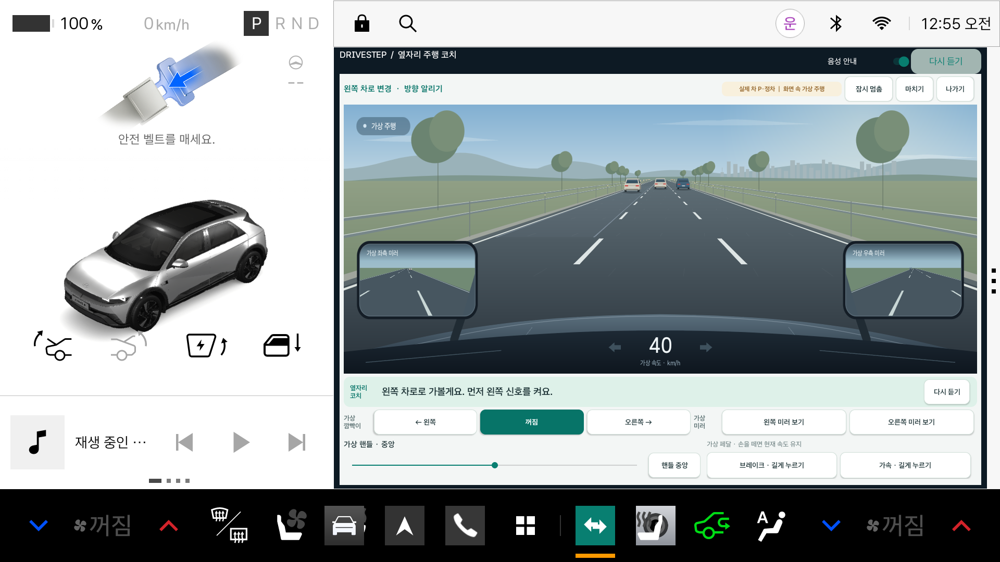
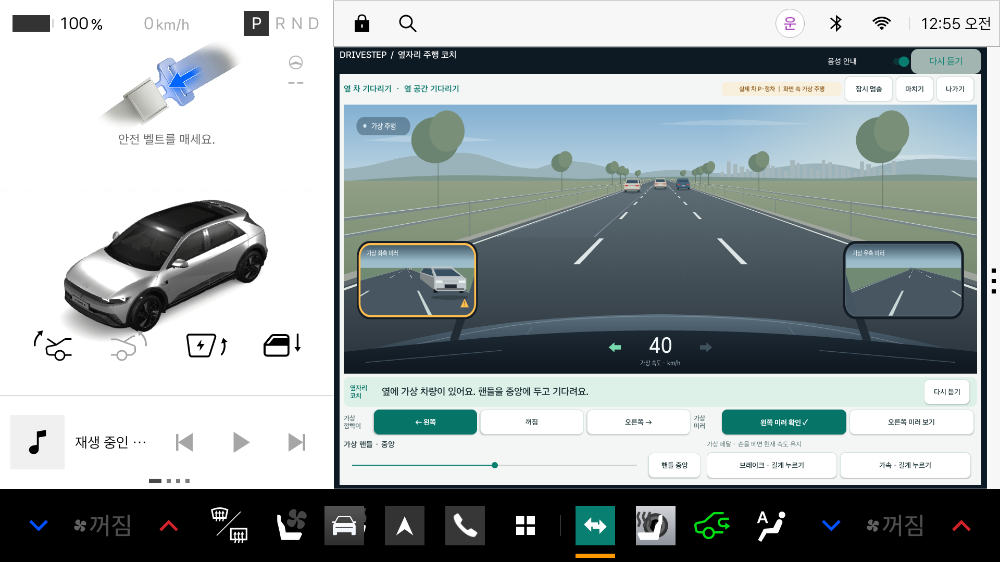
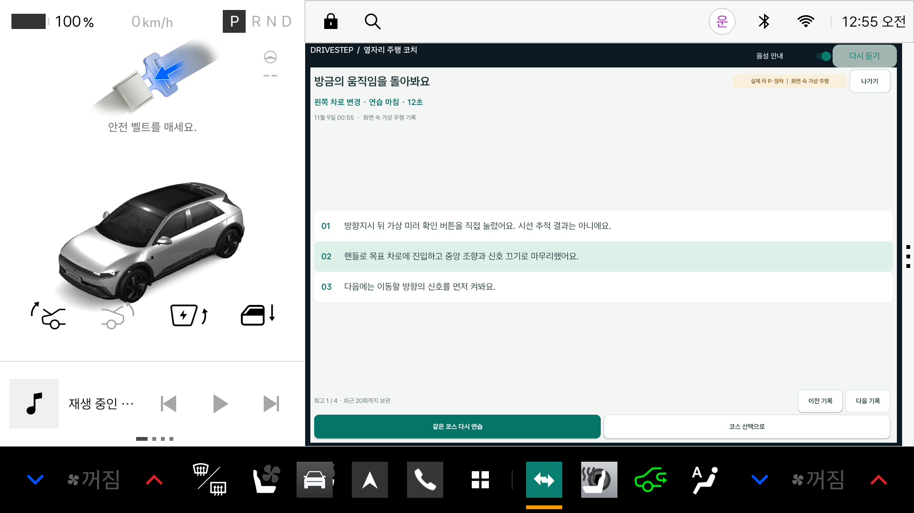

# v0.7 운전자 시점 시뮬레이터 검증

검증일: 2026-11-09. 환경: macOS ARM64, JDK 17, Pleos 에뮬레이터 2.1.0 / Android 14, 1920×1080·160 dpi. 실제 자동차에서 시험한 결과가 아닙니다.

## 빌드와 상태 모델

- Debug APK와 unsigned Release APK 빌드 성공.
- JVM 단위 테스트 **148개 통과**, 실패·오류·생략 0. 이번 시뮬레이션 상태 모델 테스트 25개 포함.
- `lintDebug` 완료, 오류 0. 기존 호환성·API 경고와 Canvas 그리기 중 객체 할당 경고 등은 남아 있습니다.
- 새 한국어 고정 문구 18개를 번들 WAV로 생성. 전체 178개 음성의 ID·텍스트·파일 해시는 `voice-assets.json`에서 관리합니다.

단위 테스트는 양방향 완료, 깜빡이만으로 이동하지 않음, 미러·신호 선행 조작, 잘못된 방향, 옆 차량 대기와 10초 늦은 미러 확인, 급격한 속도 변화, 도로 이탈·차량 겹침, 비정상 숫자·시간 입력, 일시정지 입력 해제, 종료 후 상태 불변을 확인합니다.

## 실제 에뮬레이터 화면 조작

`python3 -u scripts/verify-simulator.py` 통과. 모델 상태를 직접 주입하지 않고 보이는 버튼과 슬라이더를 ADB 터치로 조작했습니다.

| 확인 항목 | 결과 |
|---|---|
| 왼쪽·오른쪽 차로 변경 | 신호 → 미러 → 연속 조향 → 중앙 → 신호 끄기 → 완료 |
| 반대 방향 신호 | 수정 음성 재생 시작 및 개입 기록 저장 |
| 옆 차량 대기 | 가상 미러에 차량 표시 → 대기 단계 → 차량 이동 → 직접 차로 변경 |
| 급가속 | 방향지시 중 속도 변화 감지 → 안내 음성 재생 시작 |
| 일시정지 | 페달·핸들 비활성화, 음성 중지, 명시적 이어하기 |
| 다른 앱으로 이동·복귀 | 자동 재개 없음, 이어하기 필요 |
| 실제 에뮬레이터 D단 제한 | 시뮬레이션 입력·음성 중단, P 복귀 후 명시적 이어하기 |
| 기록 저장·프로세스 재시작 | 최근 회고 유지, 연습 자동 시작 없음 |
| 실제 차량 상태와 분리 | 가상 조작 완료 후 콘솔의 실제 기어 P·속도 0 확인 |

음성 검증은 Android의 재생 시작 로그와 중단 상태를 확인했습니다. 스피커에서 사람이 모든 문구를 직접 청취한 검증이나 음성 지연의 정밀 계측은 아닙니다.





화면을 직접 확인해 도로·미러·조작부가 앱 영역 안에 보이고, 주행 중 스크롤 없이 조작 가능한 것을 확인했습니다. 전체 화면과 Pleos의 분할 앱 영역에서 배치를 확인했습니다. 다른 해상도·차종의 검증은 남아 있습니다.

## 기존 SDK 실습 회귀 확인

`python3 -u scripts/verify-coach.py` 전체 통과. 기존 방향지시등 과정에서 반대 신호 교정 음성 재생과 끄기·왼쪽·끄기·오른쪽·끄기 5개 동작 완료, 기존 출발·정지/횡단보도 연습, 앱 이탈·주행 제한·회고 저장을 다시 확인했습니다. Pleos EVS 측면 카메라의 부분 화면 전환이 기존 음성을 끊지 않도록, 새 `onPause` 즉시 중지는 시뮬레이터에 적용했습니다. 실제 앱 이탈·주행 제한의 기존 차단은 유지합니다.

## 재현과 범위

```bash
./scripts/build.sh :app:assembleRelease
./scripts/install.sh
python3 -u scripts/verify-simulator.py
```

로컬 원본 로그: `.tooling/build-v07-final.log`, `.tooling/simulator-smoke.log`, `.tooling/coach-v07-regression.log`. 로그·SDK·AVD·APK는 Git 저장소에서 제외합니다. 로컬 동기화 폴더의 중복 DEX·리소스 생성물로 빌드 읽기가 지연되어, 최종 빌드는 별도 임시 출력 폴더(`/private/tmp/drivestep-v07-build`)와 캐시에서 92개 작업 전체를 수행했습니다. 같은 소스의 최종 APK를 기존 설치 경로와 실행용 폴더로 복사했습니다.

교육 효과·실차 조향감·실제 차로 변경 안전성·주행 중 사용 승인은 이번 검증 대상이 아닙니다. 가상 미러 확인 버튼은 시선 추적을 하지 않으며, 작성된 차량 움직임은 실제 주변 인식 결과가 아닙니다.
