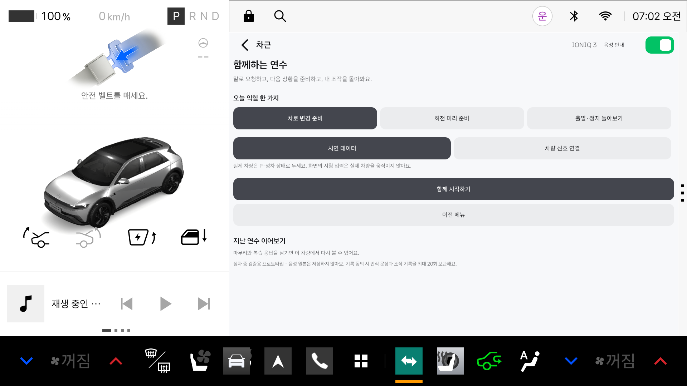
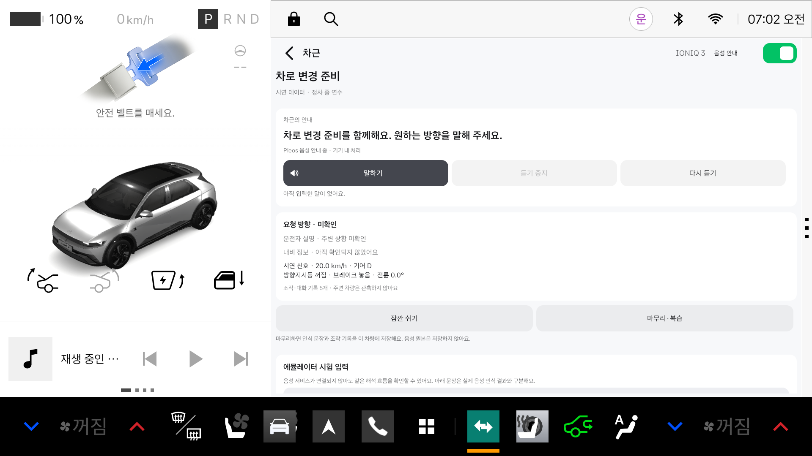

# v0.10 함께하는 연수 검증 기록

## 2026-11-10 연속 음성 대화 — 로컬 수정본

사용자는 실제 마이크 인식과 안내가 정상이라고 확인했으며, 매 답변마다 버튼을 누르는 점을 개선 요청했습니다.

- **함께 시작하기**로 연수에 들어가면 별도 마이크 버튼 없이 자동 대화가 시작됩니다. 튜터의 정상 음성 출력 완료 후 400 ms를 두고 자동으로 다시 듣습니다. 출력 중 시작해도 안내를 자르지 않고 기다립니다.
- **대화 종료**, 화면 이탈, 연수 일시 정지·마무리, 오디오 포커스 상실, 오류·입력 시간 초과는 자동 듣기도 종료합니다. 돌아오거나 늦은 SDK 콜백이 도착해도 임의로 다시 켜지지 않습니다.
- 음성의 **대화 종료 / 그만 들어 줘**는 연수 일시 정지로 처리해 확인 중이던 방향도 지웁니다. 주변 차가 멈췄다는 설명은 이 명령과 구분합니다.
- 마이크가 열린 동안은 안내를 재생하지 않습니다. 출력 완료 콜백 뒤의 대기 시간은 겹침을 줄이는 장치이며, 모든 차량의 음향 환경에서 자기 음성 인식을 완전히 배제한다는 의미는 아닙니다.

검사 결과: **JVM 274개 통과**, **Android Lint 오류·경고 0**, **Pleos 기기 검사 6개 통과**, 기존 시나리오 5개·음성 리소스 194개 검사 통과.

추가 기기 검사는 실제 Pleos TTS 시작·정상 완료 → 별도 입력 없이 STT 준비 → AudioFlinger 녹음 트랙 활성화를 확인합니다. 자동 듣기 중 새 조작 안내를 요청하면 마이크를 종료하고 안내한 후 다시 듣는지도 검사합니다. 명시적 종료·화면 비활성화·컨트롤러 종료 뒤 녹음 트랙 종료와 자동 재시작 방지도 검사합니다. 통합 UI 검사는 연수 시작만 누른 상태에서 실제 Pleos 듣기 준비까지 연결되는지 확인합니다. 단위 검사는 출력 중 입력 금지·400 ms 간격·오래된 타이머 무효화·음성 종료 명령을 검증합니다.

**이번 기기 자동 검사는 사람 목소리로 여러 차례 연속 대화한 정확도 시험이 아닙니다.** 아래 7건은 이전 수동 시작 방식의 실제 발화 결과입니다. 연속 대화의 실제 발화 시험에서는 **함께 시작하기** 이후 마이크 버튼을 누르지 않고 방향 질문·확인·안내가 이어지는지 확인해야 합니다.

## 2026-11-10 실제 마이크 추가 검증 — 로컬 수정본

이 절은 아래 최초 자동 검증과 구분한 추가 결과입니다.

### 실제 확인한 흐름

- macOS에서 Codex의 마이크 권한이 꺼져 있었습니다. 사용자가 직접 켠 것을 설정 UI에서 확인했습니다. 권한 변경 직후에는 최종 인식이 되지 않았고, 에뮬레이터를 완전히 종료한 뒤 `-allow-host-audio`로 실행하고 호스트 마이크를 켠 이후 사람 목소리가 정상 전달됐습니다. 이 조치 중 하나만을 단독 원인으로 확정하지 않습니다.
- 재시작 전 입력 RMS 최댓값은 약 0.3~0.6이었고 최종 문장이 없었습니다. 재시작 후 실제 발화에서는 약 650~1,416의 최댓값과 자연 종료·최종 결과를 확인했습니다. RMS는 dB나 인식 정확도가 아닙니다.
- 직접 발화한 **7문장**이 `운전자 음성`으로 저장됐습니다. 예: `좌회전할 거야` → 회전 방향 확인, `왼쪽 차선` → 왼쪽 차로 변경 확인, `맞아` → 미러·사각지대 준비 안내. 실제 `STT_FINAL_RECEIVED`와 Pleos TTS 시작·완료 콜백이 이어졌습니다.
- `마무리·복습`에서 중립 시험값 `보통이었어요`를 선택해 저장했습니다. 이는 테스트를 위한 복습 응답이며 운전 능력 평가가 아닙니다. 저장된 연수는 `liveInputs=true`, 차량 관측 출처 `SDK`, 총 160개 이벤트이며 음성 7문장과 되묻기·안내·복습이 보존됐습니다. 음성 원본은 저장하지 않았습니다.
- 실제 에뮬레이터 차량은 P·속도 0입니다. 주변 차량 감지나 실제 차로 변경 성공을 검증한 것은 아닙니다.

### 최종 로컬 검증 결과

| 검사 | 결과 |
|---|---|
| 앱·기기 테스트 APK 빌드 | 성공, 수정본을 실행 중인 에뮬레이터에 설치 |
| JVM 단위 테스트 | **267개 통과, 실패·오류·건너뜀 0** |
| Android Lint | **오류 0·경고 0** |
| Pleos 기기 테스트 | **5개 통과** — 마이크 중지 시 AudioFlinger 녹음 트랙 종료 3회 포함 |
| 최신 APK 설치·앱 재실행 후 복습 | 실제 음성 7건을 포함한 160개 이벤트 유지, 순서대로 보기·멈추기 확인 |
| 테스트의 기존 데이터 보존 | 실행 전 연수 6건 모두 유지, 차량·기록 동의 설정도 이전 값으로 복원 |

자연어 해석 수정은 실제 수신했던 문장을 회귀 테스트에 넣어 확인했습니다. 수정 후 동일한 전체 대화를 사람 목소리로 다시 반복한 결과는 아닙니다. 음성 출력은 TTS 시작·완료 콜백까지 확인했으며, 사용자의 최종 청취 품질 평가는 별도입니다.

### 시험 중 발견해 수정한 문제

1. **마이크 중지 후 서비스가 계속 녹음함:** SDK `stop()` 직후 `release()`하는 기존 코드에서 앱 타임아웃 뒤에도 같은 CAAS 인식 작업이 수분간 유지됐습니다. 중지 후 바인더를 최대 1초 유지하고 새 요청을 대기시키도록 수정했습니다. CAAS 4.2.10에서 명시적 중지의 `onEndedRecognition`은 관측되지 않았습니다. 타이머를 종료 확인으로 간주하지 않으며, 강화된 기기 검사는 AudioFlinger의 실제 CAAS 녹음 트랙 활성·종료를 3회 확인합니다. 1초 대기는 이 버전의 에뮬레이터에서 검증한 우회 처리로, 모든 서비스·실차에 대한 보장은 아닙니다.
2. **오래 대기하면 대화가 기록에서 밀림:** 반복 차량 관측이 160개 한도를 채우면서 앞선 발화와 안내를 없애던 문제를 수정했습니다. 이전 차량 관측을 먼저 줄이고, 대화·안내·복습과 최신 차량 관측을 보존합니다. 대화 자체가 한도를 넘으면 오래된 대화부터 줄입니다.
3. **실제 자연어의 상황 정보 누락:** `차가 너무 많은데 어떻게 해야 될지 모르겠어`의 행동 고민을 관측 불확실성으로 오해해 혼잡 정보를 지웠습니다. 행동 방법에 대한 고민과 `차가 많은지 모르겠어`라는 관측 불확실성을 분리했습니다. 실제 수신 문장을 사용한 회귀 검사로 혼잡 → 방향 되묻기 → 확인 → 안내 연결을 검증합니다. 최초 저장된 실제 대화 기록은 당시 응답 그대로 보존하며 수정된 응답으로 덮어쓰지 않습니다.
4. **시험 뒤 기록 설정이 잘못 복원됨:** 통합 테스트가 실제 저장소 `drivestep_journey_v1` 대신 존재하지 않는 `drivestep_journey_v08`을 읽고 있었습니다. 실제 키로 수정해 원래 동의를 복원하도록 했습니다.

### 재현할 때 구분할 항목

각 답변도 **말하기**를 눌러 입력합니다. 현재는 자동 재청취나 자유로운 중간 끼어들기를 구현한 음성 비서가 아닙니다. `맞아요`처럼 별도 확인을 요구하며, 한 문장에 확인과 추가 요청을 섞으면 다시 물을 수 있습니다. 짧은 문장 시험의 성공을 일반적인 한국어 인식률로 표현하지 않습니다.

기기 검사의 합성 PCM 인식, 시험 문장 UI 검사는 실제 사람의 발화 시험과 구분합니다. 마이크 권한·CoreAudio 오류·호스트 입력이 다른 장치에서는 별도 확인이 필요합니다. 앱 진단 로그에는 단계와 RMS 집계만 남기지만 개발용 Pleos 서비스 로그에는 인식 문장이 포함될 수 있습니다.

---

## 아래는 최초 자동 검증 당시의 기록

아래의 261개 검사 수와 사람 음성 미검증 설명은 당시 결과입니다. 현재 추가 검증 범위는 문서 상단을 참고하세요.

최신 원격 `main`의 `92163b9`를 반영한 뒤 음성·내비·차량 신호·복습을 연결했습니다. 아래 결과는 이 변경의 실제 실행 기록입니다. 사람 음성 인식률이나 실도로 사용 인증 결과가 아닙니다.

## 환경

- macOS Apple Silicon, JDK 17, Android API 34 Pleos 에뮬레이터, 현재 Android 사용자 10.
- CAAS `4.2.10-coral-aosp` / `4002010`.
- Vehicle SDK 2.3.2, SpeechToText/TextToSpeech 3.3.1 ON_DEVICE, NaviHelper 3.0.5.
- 실제 에뮬레이터 차량 P·속도 0, CAR_SPEED 권한 허용. 차량을 움직이는 제어는 테스트하지 않았습니다.
- 자동 검증은 창·호스트 오디오를 사용하지 않는 에뮬레이터에서 진행했습니다. TTS 시작 콜백과 화면은 확인했지만, 스피커 청취 품질은 평가하지 않았습니다.

## 통과한 검사

| 검사 | 실제 결과 |
|---|---|
| `assembleDebug`, `assembleDebugAndroidTest` | 성공 |
| 전체 JVM 단위 테스트 | **261개, 실패 0·오류 0** |
| Android Lint | **오류 0·경고 0** |
| 기존 시나리오·불변식 검사 | 5개 시나리오 및 타임아웃·자세·194개 음성 리소스·용어 검사 통과 |
| Pleos 한국어 TTS | 실제 ON_DEVICE SDK `onStart` 수신 |
| Pleos 합성 PCM 인식 + 방향 확인 | 실제 SDK 최종 결과가 앱의 확인 단계로 들어가고, 별도 승인 전 방향 확정이 안 되며 거절하면 후보가 지워짐 |
| 실제 컨트롤러 마이크 요청 | `request()` 준비 콜백 → 중지·비활성화 → 늦은 결과가 앱으로 전달되지 않음 |
| 실제 차량 입력 어댑터 | SDK 출처의 P·속도 0·유효 조향각·방향지시등 상태 수신, 종료 후 콜백 차단 |
| 내비 서비스 | 연결 성공, 다음 좌·우회전 정보 대기 상태 확인. 실제 주행 경로 TBT 안내는 미검증 |
| 통합 화면 흐름 | 시험 문장·되묻기·방향 정정·혼잡/정지 설명·조작 확인·가상 회전 안내·저장·복습·이어하기·재실행 통과 |
| 중단 처리 | 백그라운드에서 질문·상세 대화상자 정리, 명시적 재개 확인 |

기기 테스트는 **5개 모두 통과**했습니다. UI 테스트는 실제 `MainActivity`의 화면 동작을 이용하며, 문장 입력은 `TEXT_DEMO`로 기록합니다. 이것을 마이크 인식 성공으로 집계하지 않습니다. 기존 기록은 삭제하지 않고, 시험 연수 기록을 추가한 뒤 기록/음성 설정을 원래대로 복원합니다.

## 발견한 음성 오인식과 변경

처음에는 합성 PCM **“왼쪽 차로로 변경하고 싶어요”**가 왼쪽으로 인식되는지 검사했습니다. 실제 최종 결과는 **“오른쪽 차로로 변경하고 싶어요”**여서 정확도 검사가 실패했습니다. 같은 원본 입력에서 이 현상이 반복됐습니다.

원본 음성을 다른 문장으로 바꿔 성공 사례만 남기지 않았습니다. 대신 앱에 다음 절차를 추가했습니다.

1. 음성으로 인식한 방향은 아직 확정하지 않은 후보로 둡니다.
2. “오른쪽 차로 변경 준비가 맞나요?”처럼 인식한 방향을 되읽습니다.
3. 별도 발화의 “맞아요”를 받아야 방향별 준비 안내를 진행합니다.
4. “아니야”, 정정, 취소, 시간 초과, 화면 이탈은 후보를 취소하거나 다시 확인합니다.

현재 SDK 기기 테스트는 **인식 정확도 합격 검사가 아니라, 실제 인식 결과를 안전하게 확인·거절하는 연결 검사**입니다. 잘못 인식한 결과도 그대로 안내로 넘어가지 않는지 검사합니다. 이 확인 절차가 모든 오인식이나 운전자 확인 실수를 해결한다는 뜻은 아닙니다.

실제 사람의 발화, 차내 소음, 마이크 위치와 응답 지연을 포함한 정확도 검증은 남아 있습니다. 합성 PCM은 `androidTest/assets`에만 있으며 배포 앱에 포함되지 않습니다.

## 다시 실행

README대로 도구를 설치하고 Pleos 에뮬레이터 한 대를 실행합니다. 실제 기어는 P, 속도는 0으로 두고 앱의 차량 속도 읽기 권한을 허용합니다.

```bash
./gradlew :app:assembleDebug :app:testDebugUnitTest :app:lintDebug :app:assembleDebugAndroidTest
python3 simulation/test/runners/run_scenario_qa.py
python3 scripts/verify-lesson.py
```

기기 검사 원문은 `docs/test-results/interactive-lesson-device.txt`에 생성되며 Git에는 포함하지 않습니다. 러너는 실차 실행을 거부하고, Android의 `am instrument` 종료 코드만 믿지 않고 JUnit 성공·실패·건너뜀 여부까지 검사합니다.

이번 로컬 검증에서는 기존 생성 파일을 읽는 데 지연이 있어 Gradle의 프로젝트 캐시·빌드 출력만 `/tmp`의 새 디렉터리로 지정했습니다. 소스와 SDK 버전은 동일하며, Gradle 검사 항목을 생략하지 않았습니다. 팀원의 새 clone에서는 기본 명령을 사용하면 됩니다.

## 직접 확인할 화면





상단 **함께하는 연수 → 함께 시작하기 → 말하기**로 들어갑니다. 실제 마이크를 시험하려면 호스트 OS와 에뮬레이터의 마이크 접근을 허용해야 합니다. 마이크 입력이 없거나 지원되지 않으면 시험 입력으로 대화 흐름을 확인할 수 있으며, 화면에 출처가 구분됩니다.

카메라·주변 객체·실제 차로 변경 가능 시점 판단은 이번 구현에 포함되지 않습니다. 현재 실행 모드는 정차 중 검증이며, 실차 주행 중 사용 승인과 별개입니다.
